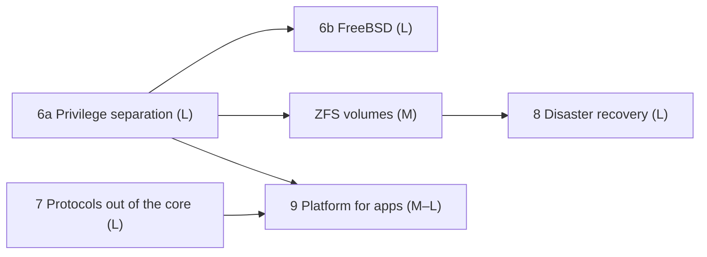

# Bulkhead: Roadmap

2026-10-16, rewritten 2026-11-10, revised 2026-11-14 · Companion to [DESIGN.md](DESIGN.md)

The single plan for remaining work: what is left, in what order, and which part of the code each piece touches. Finished work is not tracked here: [CHANGELOG.md](../CHANGELOG.md) records what landed and DESIGN.md why. The plan was rewritten on 2026-11-10 around the goals below; the plan before that, with every finished phase's narrative, is in git history (`git log -- docs/ROADMAP.md`, commit 107aab2 and earlier).

## How to use this plan

- **Phases** run in the order under "Order". Items inside a phase can run in parallel unless one names another. An item found while working on another goes into the phase where it fits, not into the current change.
- **Finishing an item** removes it from this file, adds a CHANGELOG entry, and updates DESIGN.md if a decision changed. A partly done item keeps only what is left.
- **Spikes come first** where an item says so: each answers its questions in `spikes/s<n>/README.md`, and the items after it are sized from its answer.
- **Checks** are one command, `scripts/check.sh` (`--quick` while working); CLAUDE.md's Definition of Done lists what it runs.
- **Interface docs** change with the code: CHANGELOG.md, MANIFEST.md (manifest and node config), OBSERVABILITY.md (probe and metric names), OPERATIONS.md (paths, variables, signals) and GUEST_FORMATS.md (message bodies beyond the frames). Narrative docs (README, GETTING_STARTED, WRITING_APPS, DESIGN prose, ARCHITECTURE, the tutorial) may fall behind: a change that leaves one wrong adds a line to "Doc debt" below.
- **Failover and replication changes** follow V1 (below): the TLA+ model changes first and its configurations are rerun.
- **Benchmarks** run on an idle machine only, and every new boundary (a helper, a driver app, a thread's sends) is measured against the path it replaces before it becomes the default.
- **Platforms:** an item is done when it works on Linux and FreeBSD, or says plainly what is left on the other.
- **Test machines** (set up 2026-11-11; `CLAUDE.local.md` names them): work that needs root (the helper, users, cgroups, namespaces, jails, ZFS, service units) runs on a FreeBSD 15 VM, an Ubuntu 26.04 x86-64 VM and the Raspberry Pi 5, never on the development machine. The VMs share the 16-core machine's cores, so they are for function checks and soaks only; benchmarks stay on the 16-core machine and the Pi, and FreeBSD is not benchmarked (Goals). A VM is snapshotted before root experiments. `scripts/vm-pair.sh` runs a pair across the two VMs, the witness on the host (FB5); three cluster VMs follow when DR5 and FO1 need more nodes.
- **Sizes** are relative: S = days, M = about a week, L = more than a week.

## Goals

Set with the user on 2026-11-10. Bulkhead takes its failure model from Erlang/OTP and its shape from microkernels: a small trusted core, and everything else in processes of its own, talking by messages.

1. **Security first.** The core (the node) does as little as it can, parses as little untrusted input as it can, and runs without root. A compromised app must still escape its process's fence before it can do much damage, and the core kills and restarts an app that misbehaves. Apps differ in what they may do.
2. **Compartmentalization second.** Each app, each driver and the helper is a process of its own with only the rights its job needs, and what passes between them goes through the node, which checks it.
3. **Performance third.** IPC and data paths are spiked and replaced when something measures better; the project is not production software, so the implementation changes when the numbers say so. A faster path that takes the node's checks out of the way (a direct channel between two apps, a fence turned off) is not a default: it is an opt-in per profile, and only once the checked path has been measured and missed a stated target.
4. **Redundancy, fault tolerance and observability.**
5. **A common platform:** the SDK's traits and macros for writing an app, node and cluster configuration, keyvalue buckets (memory, disk, replicated; Bulkhead's ETS, DETS and Mnesia) and common logging.

Decided with them:

- **Platforms:** Linux and FreeBSD, both first-class in function: every change is tested on both (CI's suite on every push, root work on the test machines). Linux on x86-64 and aarch64; FreeBSD on x86-64, and on aarch64 compiled (`scripts/check.sh cross`, in CI) but not run, as no machine runs it. Performance is measured on Linux only (BASELINE.md: the 16-core machine and the Raspberry Pi 5): there is no bare-metal FreeBSD machine, so FreeBSD's checks, its soaks included, run on its VM (decided with the user 2026-11-16). macOS and Windows are not targets (the CLI may still build there; CI does not test it).
- **Topology:** an HA pair at one site, whose standby takes over almost at once when the primary fails, and a third node at a remote site for disaster recovery, activated by hand when the first site is lost, with at most about 5 minutes of data lost (Phase 8). Bigger machines rather than more nodes; clusters of dozens of nodes stay possible, not the target.
- **Privileges:** a small root helper is acceptable; the node and every app run unprivileged, each app under a user of its own (Phase 6).
- **Protocols leave the core:** HTTP first, then SQL, HTTP egress and Modbus, each as a driver app (Phase 7).
- **The order of the goals** (2026-11-11): security, then compartmentalization, then performance.
- **Instances are long-lived processes:** passivation was removed on 2026-11-11 (CHANGELOG.md); density is not an aim.

Non-goals:

- **Supervision trees.** The node supervises the instances it starts, and that is all: apps do not start, stop or supervise other apps, and the SDK has no API for it (E8, dynamic children, removed 2026-11-10; `supervision.children`, other apps' instances under an app's root supervisor, removed 2026-11-21 by AP3). An app uses threads of its own for concurrency. It may fork a process inside its own fence (the child inherits the sandbox and counts against `pids.max`; PS7 makes it end with the instance), but that is not a pattern the SDK supports or the docs recommend.
- **A large platform in the core.** Keyvalue and logging stay in the node; protocol stacks move out where that serves security, at some cost in latency.

## Where things stand

| Phase | Exit | Status |
| --- | --- | --- |
| 1: single node | Nine exit criteria (`crates/bulkhead/tests/exit_criteria.rs`) | Met 2026-10-06 |
| 2a: platform on one node | HTTP, secrets, logs, metrics, tracing, Modbus into a shared bucket; baselines on the 16-core machine and the Pi | Met 2026-10-18 |
| 2b: cluster | Failover on node loss, no promotion with the network cut, at most one singleton with network and serial cut, three-node partitions | Met 2026-10-16 |
| 3: application server | The SCADA app's release cycle with zero downtime under faults | Met 2026-10-22 |
| 5, 5b: native apps, native parity | Every example as a native program, the scada soak natively | Met 2026-11-01 and 2026-11-07 |
| 5c: native only (Z9) | No WebAssembly in the workspace; soaks an hour each on both machines; CI green on the pushed commits | Met 2026-11-09 (CI 2026-11-11) |
| 6: a hardened core | Instances under users of their own, started by the privileged helper; seccomp on Linux, jails and Capsicum on FreeBSD; the misbehaviour policy; the suite in CI on both systems; the scada soak an hour on the 16-core machine, the Pi and the FreeBSD VM | Met 2026-11-19 |

Measured against the goals on 2026-11-10:

| Goal | Fit | What is missing |
| --- | --- | --- |
| Fault tolerance, the pair | Strong: TLA+-checked failover and replication, leases, serial heartbeat, releases without downtime, soaks | A faster takeover profile, measured (FO1) |
| Compartmentalization between apps | Strong: a process per instance, Landlock, seccomp, node-made sockets, messaging ACLs, grants | None on Linux; on FreeBSD capability mode and their users, and a jail per instance under the helper |
| Performance | Good: a request 1.3 to 4.3 µs, a call between instances 5 to 8 µs, a published read 0.16 to 0.39 µs | Each new boundary's cost; large bodies through a driver (PF1) |
| Platform: SDK, keyvalue, logging | Good: and blobs between apps since 2026-11-15 (BL1) | Own sockets' bind and listen on FreeBSD (AP2c); durable streams |
| Observability | Good: probes, metrics, audit, events, `ps`, `state`, and since O1 (2026-11-22) a trace id across calls and nodes in log records | Exporting traces (E4b) |
| A small, protected core | Mostly: HTTP ingress and its TLS (DA2), host names (DA9), the remote admin API's TLS and the metrics endpoint (DA7) run in drivers since 2026-11-14, so no listener any client reaches is served by the node before a key is checked, SQL since 2026-11-15 (DA3), a driver per datasource holding its password, HTTP egress the same day (DA4), a driver per app, and Modbus (DA5), drivers for devices and masters; no code from outside Bulkhead runs in the node since DA8 (the `Extension` trait removed); what the node still parses from outside is SECURITY.md's list of what stays ("What the node parses from outside") | Phase 6a |
| No root; apps unprivileged | Half: nothing runs as root, but apps run as the node's user (their system calls are an allow-list since 2026-11-11) | Phase 6a |
| FreeBSD, jails, ZFS | FreeBSD done in function: native apps in capability mode (FB1), a jail per instance under the helper (FB2), bundles (FB6), the whole suite in CI (FB3), an hour's scada soak on its VM (FB4), a pair across Linux and FreeBSD with a serial line between them, DTrace and the tutorial (FB5); not measured, by decision (Goals); ZFS volumes per app since ZV1 (2026-11-22) | Replicated volumes (ZV4) |
| A disaster-recovery site | Partial: since 2026-11-19 the witness, or a node of its own, keeps a copy of the pair's replicated log (DR2) and holds the primary's deployments, not started (DR3), and an operator can activate it when site 1 is lost and fail back afterwards (DR4, operator fencing), drilled for an hour over an emulated WAN with delay and loss (DR5, 2026-11-20), with what the drill found fixed (DR3b, 2026-11-20), and a DR node apart from the witness activated through it (DR4b, 2026-11-21) | DR6 after ZFS volumes |

## Order



- **Security before features.** Phases 6 and 7 come before new platform features, and before tuning that is not measuring a new boundary.
- **Next:** the open Phase 7 threads by the order above; Phase 8 waits on replicated ZFS volumes (ZV4, then DR6) and DR4c's TLC runs.
- **While TLC runs** (DR4c holds 12 of the 16-core machine's cores for hours at a time), take items whose result is not a benchmark, such as ROADMAP's smaller open items (DA4b's security part and ZV1 to ZV3 done 2026-11-22). Items measured by a benchmark (AP1b, PF1, PF2, O1b, FO1) wait for an idle machine (their numbers would be contended); `scripts/overnight.sh` runs the baselines on both machines at once (BASELINE.md, 2026-11-23).
- DA3b (worker threads in the SQL driver, a pool each) and DA4b's threads in the egress driver on 2026-11-23; DA5c (Modbus writes by tag) on 2026-11-22; DA5b (typed Modbus tags), DOC1 (the app tutorial, `examples/app-tutorial`), AP4 (unconfined apps, consent on four sides), AP3 (flat supervision: `supervision.children` removed) and DR4b (a DR node apart from the witness) landed on 2026-11-21; DR3b (what DR5's drill left) and DR5 (the drill and its soak) on 2026-11-20; DR4 (activation and failback, operator fencing) on 2026-11-19, with DR2 and DR3 the same day; Phase 6's exit was met that day too, and PS6b removed the CPU limits by decision.
- **The helper before the FreeBSD runner and ZFS**, since jails, a uid per app and datasets all need it, and one helper does all three.
- **Driver apps do not wait for the helper:** a driver runs under the node's user without it, and under a user of its own with it, as any app (PS2).
- **Disaster recovery in parallel** with Phases 6 and 7: it touches replication, failover and the transport, which they do not. Its model (S38) came first, under V1 (done 2026-11-18). Shipping volumes (DR6) waits for ZFS volumes.
- **Phase 9 after 6a and 7**, since own sockets lean on the helper and the driver profiles. Sends from an app's own threads (AP1) went ahead of DA1 into Phase 7 and landed on 2026-11-12.

### Verification of failover

- **V1 The rule for failover and replication changes.** A change to a transition in `failover/` updates the matching action in `FailoverL2.tla`, and one in `replication/` the matching action in `spikes/s20/PairReplication.tla` (CLAUDE.md). A change to disaster recovery (activation, fencing, the DR copy, reseeding, the hand-back) updates `docs/tla/DrFailover.tla` or `DrReplication.tla` and reruns `DrF_Operator_Site1` (about 45 minutes) and `DrR_Operator_Site1` (about an hour). Before it lands, rerun the configurations it can affect: `L2_Crashes_Fixed1` (about 20 minutes) for anything touching restarts, epochs or the witness, and `L2_Links_Fixed_holds1` (about 2.5 hours) for heartbeats, leases or links. Random simulation of the two-fault configurations runs for at least 20 minutes. The vacuity checks, `L2_Vacuity` and `L2_Switchover_Reach`, must still fail (seconds each): a model in which nothing runs on a lease passes every safety property (VERIFICATION.md, bug 5). Record the results in VERIFICATION.md.
- **V2 The two-fault runs.** `L2_NoSerial` (about 1 hour), `L2_Links_Fixed_loss2` (about 12 hours) and `L2_Crashes_Fixed` (about 18 hours, 250 GB of disk), exhaustive, on an idle machine, each with a fingerprint polynomial (`-fp`) not used before. Rerun after Phase 8 changes failover, and before a release.

## Phase 6: a hardened core

Exit: on Linux and FreeBSD, every app's instances run under a user of their own, started by the privileged helper, with the node unprivileged, holding no capabilities and not dumpable; Linux apps run under a seccomp allow-list (done 2026-11-11) and FreeBSD apps in a jail in capability mode; an app past the misbehaviour policy is killed and then quarantined (PS5, 2026-11-16); CPU limits per app were built (PS6, 2026-11-16) and removed by decision (PS6b, 2026-11-19: the `cpu` controller cost every call; parked); the board, scada and failover node tests pass on both systems in CI (the whole suite since FB3, 2026-11-16; CI's first FreeBSD run comes with that push), and the scada soak passes an hour on the 16-core machine, the Raspberry Pi 5 and the FreeBSD VM (no bare-metal FreeBSD machine exists; decided 2026-11-16). The FreeBSD VM's hour passed on 2026-11-16 (FB4): a 60-minute run (229 singleton starts and 58 heals under link faults, kills and pauses, with no overlap, once the soak's check stopped reporting a false one) and a 24-minute one; resident memory rose at most 9.3 MiB in any node process's life. The Linux hours passed on 2026-11-19 at the commit after PS1b's aarch64 check: 3,610 s on the 16-core machine and 3,609 s on the Raspberry Pi 5 (its new drive, ZFS `/home`), with no overlap; resident memory rose at most 7.5 and 8.6 MiB. Neither run kept its logs, so their singleton starts and heals were not counted. **Phase 6's exit is met (2026-11-19).**

### 6a: privilege separation

The helper is built (PS1, 2026-11-11; OPERATIONS.md, "The privileged helper"; SECURITY.md): `bulkhead-priv`, started as root by systemd or rc, starts the node under its user and, with node config `[priv]`, each instance under its app's user, picked and kept by the helper; on Linux in a cgroup, five namespaces and a minimal root, ended by the node through `cgroup.kill`; on FreeBSD in a process group with `RLIMIT_AS` and per-process `rctl` rules. Since PS2 (2026-11-12) an app's files are given to it once, when the node writes them (`Share`), the node's own are its alone (umask 077), and a start shares nothing. Its checks are its own configuration's; its wire format is a crate that forbids `unsafe` and is fuzzed; its `unsafe` is one module, on rustix where rustix has the call (PS1 chose rustix over `libc` alone: safe wrappers for credentials, mounts, `pivot_root`, pidfds, capabilities, at the cost of one dependency in root code). It keeps nine capabilities and `no_new_privs` after starting the node. Measured on the Pi: a start about 1.3 ms more, a call 2.7 µs more (BASELINE.md, 2026-11-11), nearly all of it the `cpu` controller on every instance's cgroup (PS1c, BASELINE.md, 2026-11-19); between nodes, 3 to 7% of concurrent calls. The controller is off since PS6b (2026-11-19), which removed the CPU limits; instances keep `memory` and `pids`, and a call under the helper costs 0.3 to 0.5 µs more than directly (BASELINE.md, 2026-11-19). Its own seccomp allow-list came with PS1b, and the node's low TCP ports bound by the helper with PS3b, so the node holds no capabilities (both 2026-11-16; SECURITY.md). Network rules for apps that open their own sockets came with AP2 (2026-11-22). Without `[priv]` a node works as before, every app under the node's user; `bulkhead status` says which.

No items left: PS6b was the last (2026-11-19).

### 6b: FreeBSD

Since FB1 (2026-11-11) the node runs native apps on FreeBSD: the port, the rings and published snapshots (sealed memfds, which FreeBSD makes as anonymous shared memory objects), the parent-death signal, the lease watchdog, the node's fence and the listener's idle timeout, with what differs in `native/os`. Checked on the FreeBSD 15 VM: the native conformance suite (42 cases), the listener tests, and every other `bulkhead-host` integration test once its gate is widened, but the six that test the runner's sandbox. What is still Linux-only: cgroups (under the helper a jail's `rctl` rules stand in) and rustbridge plugins; bundles for FreeBSD came with FB6 (2026-11-15), and the test gates and CI with FB3 (2026-11-16: the whole suite passes on FreeBSD 15, and CI runs it there on every push, in place of macOS). Since FB2's first half (2026-11-12) the runner fences an app with Capsicum there (SECURITY.md, "FreeBSD"). PB5 ran apps in jails with Capsicum on FreeBSD 15 (2026-10-31) and found:
- Capsicum rights survive an fdescfs reopen.
- Jails that share a root path share POSIX shared memory, so each app needs a root of its own.
- kvmclock needs `/dev/pvclock`, or clock reads become system calls.
- Rust's std opens `/dev/null` when stdio lacks `CAP_EVENT`.
- A dying jail frees asynchronously, so nullfs unmounts retry on `EBUSY`.

No items left: FB5 was the last (2026-11-17).

## Phase 7: protocols out of the core

Decided with the user on 2026-11-10, reversing DESIGN.md's earlier rule ("terminate I/O and protocols in the host"). That rule came from components' costs: an instance per HTTP request kept about 15% of native throughput (S15). A native process does not pay them. A protocol that parses input from outside the node now runs in a driver app: a process of its own, under its own user and sandbox profile, holding only the descriptors and secrets its job needs, supervised and restarted by the node as any instance is.

The node keeps mailboxes and routing, supervision, keyvalue and replication, logging, failover and the cluster transport (whose peers are authenticated before any frame is parsed), deploys and policy, and the admin API. That is a small core with its drivers outside it, not a microkernel: storage, replication and the transport share the node's address space, by the non-goal above. What of it still reads bytes from outside is listed in SECURITY.md, "What the node parses from outside".

Confirmed by S37 (2026-11-11, `spikes/s37/README.md`), with what it changed:
- **A driver app** is a native program the operator configures in node config (`[drivers.<name>]`), not one a bundle's manifest can make itself. Its profile adds narrow rights: listening sockets passed to it with `accept4` allowed on them only; certificate and key files, read-only; a datasource's credentials; calls only to the apps whose routes it serves.
- **Its messages** go through the node as any app's do, stamped with its own app name, so messaging ACLs apply to it: a compromised ingress driver can send what its ACL allows and nothing else.
- **Listening sockets stay the node's** (bound by the helper for low ports), so a driver's restart or upgrade does not close the port; connections in flight in a crashed driver are lost.
- **The driver accepts, reads and writes its connections itself** (S37): with the node accepting each connection and sending a notice for each read, as it does for an app's listeners, getting the bytes to the driver cost as much as a whole request in the node's own ingress.
- **A driver keeps many calls in flight**, from its own threads, answered by id (S37): with one blocking call per instance, 4 drivers held 4 requests and served 39 to 52% of the node's own requests a second at 32 connections; 8 served 83% on the 16-core machine.
- **The target:** a request through a driver costs at most 1.5 times the node's own ingress's CPU, and serves at least two thirds of its requests a second at 32 connections, HTTP and HTTPS, on both machines; one connection's p50 no more than 20% above the node's (S37; the prototype missed it, at 2.4 to 3.1 times the CPU). DA1's driver meets it on both machines since 2026-11-13 (DA1b: the driver's thread spins 50 µs for its answer, `[native] sender_spin_us`), but for HTTPS on one connection on the Pi, 22 to 23% above the node's (BASELINE.md, 2026-11-13).

Exit: the node parses no ingress client's bytes and holds no ingress TLS key; every parser of outside input left in the node is listed in SECURITY.md with the reason it stays ("What the node parses from outside"); the node's dependency tree is checked for what has left (CR1); HTTP ingress runs as a driver app, with its node tests (`http.rs`, `board.rs`, the scada HMI) and the scada soak passing; SQL, egress, Modbus and name lookups moved, or kept in the node with the reason in DESIGN.md (DA6 kept the UDP relay, listeners' accepts and bundle parsing on 2026-11-14). HTTP's part met on 2026-11-14 (DA2): the ingress driver, its node tests and an hour's scada soak on the 16-core machine. Name lookups moved on 2026-11-14 (DA9), SQL and HTTP egress on 2026-11-15 (DA3, DA4), and Modbus the same day (DA5: its drivers, `scripts/check.sh deps`, the scada tests and an hour's scada soak on the 16-core machine, 6 runs passing). Met on 2026-11-15; DA8 removed the `Extension` trait the same day; the open threads remain as items (DA4b); DA2b closed on 2026-11-22, DA3b on 2026-11-23.

CR1 (crates along trust boundaries) finished on 2026-11-21 (CHANGELOG.md): each protocol stack that left the node went with its driver's crate (DA2 to DA5, DA9), and the runner left `bulkhead-native` for a crate of its own, `bulkhead-runner`, so the node, the SDK and the drivers link no sandbox; `scripts/check.sh deps` checks every one.

Items:

- [ ] **AP1b What sender channels left** (S). AP1 landed 2026-11-12 (CHANGELOG.md; DESIGN.md, "App model"): measured on the Pi only, a request and a bucket get from a sender cost what a callback's do and 800 idle senders cost nothing (BASELINE.md, 2026-11-12). Left (800 idle senders cost nothing on the 16-core machine either, and a sender's request what a callback's does: BASELINE.md, 2026-11-23): `cluster_throughput` with senders open; why a sender's call to another instance takes about 5.3 µs longer than a callback's on both machines (13.9 to 14.8 µs against 8.4 to 9.3 on 16 cores, 10.5 to 11.1 against 5.3 to 5.6 on the Pi; `native_cost` measures both, and 64 calls in flight from one sender, since 2026-11-23); a sender's reads of a published bucket from its snapshot, as the callback thread's are (a sender's go to the node today). A reply from a sender channel landed with DA3 (2026-11-15: `Request::Reply`, used by the resolver and SQL drivers). Areas: benchmarks, `bulkhead-native`'s `sender`.
- [ ] **DA4b What the egress driver left** (M; DA4 landed 2026-11-15: `crates/bulkhead-egress`, DESIGN.md "HTTP egress"; the deny list of private ranges, a proxy by `CONNECT`, client certificates per app and the roots read again on `reload-tls` landed on 2026-11-22). Worker threads with a pool each landed on 2026-11-23 (`[egress] threads`; on 16 cores 2 to 19% more requests from 16 instances at once, BASELINE.md); the rest of the path now limits it there. A 1 MiB response takes 1.6 to 2.8 ms more, crossing the node's channel twice: PF1 (S42 put the rings' own cost for it at 0.4 to 0.9 ms). HTTP/2. Proxy authentication and a no-proxy list, if a site needs them. Areas: `bulkhead-egress`, services (`egress`), node config.
- [ ] **BL2 Bodies too large for a frame** (S; after PF1; BL1 landed 2026-11-15: `bulkhead:blobs`, DESIGN.md "Blobs"). An HTTP request or response body over the 16 MiB frame limit, or shared by many readers, as a blob between the ingress or egress driver and the app; smaller bodies stay in frames (S42: a blob costs about 100 µs before its first byte and a fault per 4 KiB, so the rings are faster up to about 1 MiB, and blobs save CPU only toward 20 MiB). Areas: `bulkhead-ingress`, `bulkhead-egress`, host, SDK.
- [ ] **BL3 Blobs that outlive a process** (M; later). A blob kept in a spool directory under `data_dir` (or a ZFS dataset once ZV1 lands) for data that must survive a restart, such as a 20 MB file handed between apps; and blobs to another node over the cluster transport, and to the pair's standby. Areas: host, transport, replication.
- [ ] **DA5b What the Modbus drivers left** (S; DA5 landed 2026-11-15: `crates/bulkhead-modbus`'s drivers, DESIGN.md "Host services"; typed tags landed 2026-11-21). A second worker thread in the devices' driver if one is ever the limit (`modbus_load` found the pool and its bucket the limit, BASELINE.md 2026-11-15), measured with tags declared too; Modbus RTU stays parked. Areas: `bulkhead-modbus`.

## Phase 8: disaster recovery

The target topology: the HA pair at site 1 and a third node at site 2. Today the third node is a witness only and holds no data.

Goal: the site-2 node keeps a copy of the pair's replicated state and deployments, at most about 5 minutes behind (best effort and asynchronous: the pair never waits for it), and an operator can activate it when site 1 is lost.

Decided with the user (2026-11-10): asynchronous, with a target of 5 minutes of data lost at most; activation by hand.

What S38 found (2026-11-18; `spikes/s38/README.md`):
- **The DR node** is the witness as well (one machine at site 2), or a node beside a witness elsewhere; both are configurations. The second has only operator fencing (below).
- **Shipping:** the pair ships the replication log of `cluster` and `replicated` buckets in batches, committed entries only: an entry shipped before it commits can be replaced by a failover at site 1, and the DR node's copy then contradicts an acknowledged write. Any node may ship it, the standby (so the primary does no extra work) or the primary while it has no standby. The DR node catches up from a snapshot when it falls behind the log's retention. Deployments (bundles and grants) are shipped too, so activation needs no redeploy. Node config, secrets and keys are the operator's to keep at site 2 (OPERATIONS.md).
- **Lag:** `bulkhead_dr_lag_seconds`, and a warning past `[dr] rpo_target` (default 5 minutes).
- **Activation:** `bulkhead dr activate` on the DR node. It refuses the pair every grant and renewal, waits, takes a new epoch and starts the singletons from its copy; the writes lost are exactly those after its last applied entry. The wait proposed first (a lease and its margin) is not enough: a site-1 primary renews through its partner's beats as well as at the witness, so a site 1 whose nodes hear each other runs on beside the DR node, with no fault at all and when site 1 is alive and cut off. One of two remedies makes it safe:
  - **A site lease** (`[dr] site_lease_ms`): a primary runs singletons, and commits, only while it also holds a lease that only the DR witness renews; activation waits it out, so a live site 1 cut off from site 2 stops by itself. Its costs: a site-2 or WAN outage longer than the site lease stops site 1's singletons and writes, and `failover confirm` at site 1 cannot run a singleton while site 2 is unreachable. The witness keeps when it last renewed one in memory, so after a restart it counts as just renewed.
  - **Operator fencing:** activation waits for the operator to confirm that site 1 is down or fenced, as `failover confirm` does today. The pair stays independent of site 2; safety rests on the operator (A9).
  Decided with the user on 2026-11-19: operator fencing only, on a DR node that is also the witness (DR4); the site lease is parked. A DR node of its own followed as DR4b (2026-11-21).
- **Failback:** site 1's nodes rejoin as standbys of the DR node, each taking its committed log and dropping what it had after the DR node's point, its commit index included (S20's rules only raise one); then the DR node hands back through a new epoch at the witness.


DR2 landed on 2026-11-19 (CHANGELOG.md; DESIGN.md, "Shipping to the DR node"): the DR node pulls committed entries from either pair node, decided with the user that day, so the pair keeps no state for it and the source follows a failover by itself. Not measured over a real WAN; DR5's drill ran it over an emulated one.

DR3 landed on 2026-11-19 (CHANGELOG.md; OPERATIONS.md, "A disaster-recovery copy"): the DR node pulls the primary's deploy state and bundles and holds them deployed and not started, built against its own keys, policy, secrets and buckets; grants come from site 2's policy and a difference from the primary's is reported (decided with the user that day). DR4's activation starts the held apps (`restore`, which a DR node skips until then).

DR4 landed on 2026-11-19 (CHANGELOG.md; OPERATIONS.md, "A disaster-recovery copy"; DESIGN.md, "Activation and failback"): `bulkhead dr activate --site-1-down` and `bulkhead dr failback --to N`, with operator fencing only, on a DR node that is also the witness, and failback by reseeding each site-1 node from a full snapshot of the DR node (all decided with the user that day). S38's models moved to `docs/tla`, with the conformance of the code (VERIFICATION.md, "Disaster recovery"); rerun from there, `DrF_Operator_Site1` and `DrR_Operator_Site1` found the same states as in S38. Not measured over a real WAN; DR5's drill ran it over an emulated one.

DR5 landed on 2026-11-20 (CHANGELOG.md; tutorial chapter 7): `bulkhead-soak dr` (in `scripts/soak.sh`'s default set) and `examples/tutorial/07-disaster-recovery.sh`. An hour of it, with 50 ms (up to 70 ms) of delay and 5% loss each way between the sites: 51 cycles of loss, activation and failback, 25,862 writes, 25,861 acknowledged and none refused; 3,330 acknowledged writes lost at activations, each within the lag the DR node had reported; no singleton on two nodes at once and no acknowledged write missing after failback. A reseed took from about 1 s early in the hour to 26 s at the end, growing with the bucket's snapshot; the pair's apps reached the DR node in 96 s. What the drill found:
- **Reseeds stalled** once a snapshot took more than one chunk: a chunk unanswered within 2 s was asked again, and over this WAN a 1 MiB chunk takes 10 to 20 s, so copies queued ahead of everything after them. A chunk is now asked again when the session changes, or after 60 s; a reseeding node probes until the DR node answers on the session; and the DR node keeps a snapshot per pair node (CHANGELOG.md).
- **An activation asked within the WAN's delay of site 1's loss** was abandoned: a renewal still in flight reached the witness while it fenced, which it treats as site 1 alive, as designed. The drill waits a second before activating; an operator confirming site 1 down takes longer than that.

DR3b landed on 2026-11-20 (CHANGELOG.md; spike S43): what DR5's drill left.
- **Transfers:** S43 measured the drill's WAN: about 40 KiB/s with quinn's Cubic for chunks of any size, held down by the emulated link's reordering more than its loss; the size sets how long other frames between the two nodes wait behind a chunk, 23 s at 1 MiB. Snapshot and bundle chunks went to 256 KiB (6 s), a reseed's batches to 1 MiB, and a bundle chunk's backstop to 60 s (decided with the user). A stream for bulk frames and BBR are an investigation for a real WAN.
- **Asking again:** a batch of entries, like a snapshot chunk, is asked again only when the session changes or after 60 s, probes first on a new session.
- **Activation** is refused while the DR node does not hold the primary's deployments, unless `--allow-missing-apps`.
- **The DR node's memory** grew with each cycle of activation and failback, not with the data (20-minute soaks with writes alone, and with a twentieth of the writes). heaptrack put its live heap under 10 MB throughout and at 5.7 and 5.9 MB after 9 and 30 cycles, the difference in caches with bounds (redb's pages, rustls's sessions): freed memory glibc keeps in its arenas, reused, not returned. With `MALLOC_ARENA_MAX=2` and fixed trim and mmap thresholds the node's anonymous memory stayed about 4 MB (the 16-core machine, 2026-11-20); see "Smaller open items".
- **An hour of the drill after it** (the 16-core machine, 2026-11-20, DR5's seed): 52 cycles, 26,521 writes, 3,513 acknowledged writes lost at activations, each within the lag reported; the pair's apps reached the DR node in 49 s (96 s before); site 1's return to failback took 5 to 26 s as before, growing with the bucket; the DR node's resident memory grew 38 MiB (49 MiB before).

DR4b landed on 2026-11-21 (CHANGELOG.md; OPERATIONS.md, "A disaster-recovery copy"; DESIGN.md, "Activation and failback"; VERIFICATION.md, "Disaster recovery"): a DR node apart from the witness (`[dr] witness`, `[witness] dr`), activated and failed back through the witness, which stays the one authority. The DR node sends it its intent every poll and follows the state it answers with, so a lost answer or a restart recovers at the next one; a hand-back without the witness's word stays frozen. Model-checked first (`DrFailover.tla`'s `DrApart`). The drill with a fourth node (`bulkhead-soak dr --apart`) found that a fence still in flight after an abandoned activation fenced again and promoted the DR node unasked; a fence now names the operator's activation. An hour of it (the 16-core machine, 2026-11-20, TLC running beside it at low priority): 53 cycles, 24,286 writes, 2,322 acknowledged writes lost at activations, each within the lag reported, 12 activations refused with site 1 reachable, none taken up later.

Items:

- [ ] **DR4c Finish DR4b's exhaustive check** (S, mostly TLC time; added 2026-11-21). `DrF_Apart_Site1` was stopped at depth 176 with 6.6 billion distinct states, its queue still growing (57 million), and no violation; its 175 GB of checkpoints were removed. Split by the kind of fault on the DR node's side, with the DR node's frames no longer aging (nothing reads their age), and run one after another: `DrF_Apart_Site1_None` (none), `_Link` (its link to the witness lost), `_DCrash` (it crashes), `_WCrash` (the witness crashes); then the negative controls `DrF_Apart_Unfreeze` and `DrF_Apart_TrustDisk` again on the changed model, each of which must be violated. Started 2026-11-21 15:36 by `~/tla-runs/dr-2026-11-21/chain.sh` (detached), results in that directory's `summary.txt`. `_None` (2 h 38 min) and `_Link` (16 h 2 min) finished with no violation (VERIFICATION.md). Stopped by hand 2026-11-22 14:24 to free the machine, `_DCrash` 4 h in, at 1.68 billion distinct states (35 million queued, no violation); `_WCrash` and the two controls not started.
  - **To resume:** on an otherwise idle machine, with `docs/tla` unchanged since the run began, `setsid nohup ~/tla-runs/dr-2026-11-21/resume.sh > ~/tla-runs/dr-2026-11-21/resume.out 2>&1 &`. It runs TLC with `-recover` on `_DCrash`'s last checkpoint (14:18; 63 GB in `~/tla-runs/dr-2026-11-21/DrF_Apart_Site1_DCrash/26-11-22-10-17-45.206`, same 12 workers and 30 GB heap, log `DrF_Apart_Site1_DCrash-resumed.log`), then `dr-run.sh` for `_WCrash`, `DrF_Apart_Unfreeze` and `DrF_Apart_TrustDisk`, appending each to `summary.txt`. If the model changed, or the checkpoint was removed, start `_DCrash` afresh with `dr-run.sh` instead (delete its directory first). Follow it with `tail ~/tla-runs/dr-2026-11-21/DrF_Apart_Site1_DCrash-resumed.log`; stop it by killing `resume.sh` first, then the `java` process, or the script starts the next config.
  - Record the results in VERIFICATION.md ("A DR node apart from the witness"); a piece that does not finish in a day is stopped and recorded as far as it got, with random simulation (`DrF_Apart1`, `DrF_Apart2`) for breadth. Areas: `docs/tla`.
- [ ] **DR6 Volumes to the DR site** (M; after ZV1, with ZV4). Incremental `zfs send` of each replicated volume to the DR node on an interval within `rpo_target`. Areas: replication, helper.
- [ ] **FO1 A fast takeover profile** (S–M). A crashed primary hands over in about 9 to 10 s with the defaults (5 s node timeout, 3 s lease, margins); a planned switchover takes about 200 ms. Measure a profile for a pair with a serial line (for example 100 ms beats, a 1 s node timeout, a 1 s lease): the takeover time and any false promotion under load on both machines (the Pi with every core busy) and on FreeBSD. Then document it in OPERATIONS.md. Only parameters change, so the model's rules stand; its `Lease` constant is rechecked at the new ratio. Areas: tests, soak, docs.

## ZFS volumes

Planned on 2026-11-06, with the user. Before ZV1 a volume was only a host directory the operator names in `[volumes]`, granted read-only or read-write; Bulkhead enforces no byte quota and refuses a manifest `quota` on one (S6), so a writable volume is bounded only by a filesystem quota the operator sets up (SECURITY.md). With ZFS, the operator hands the node one parent dataset and the node cuts it into a dataset per app volume, with the quota the manifest asks for, capped by node config:

```toml
# node config
[volumes.zfs]
parent = "tank/bulkhead/volumes"   # the node creates datasets under this one only
max_quota = "50G"                  # the largest quota a manifest may ask for

# app manifest
[preopens]
"/data" = { volume = "orders-data", mode = "rw", quota = "10G" }
```

- **Apps see no difference:** a native app gets a Landlock rule (Linux) or a directory descriptor in its jail (FreeBSD) on the dataset's mountpoint, and its path in `BULKHEAD_PREOPENS`; at the quota, writes fail with `EDQUOT` or `ENOSPC`. Plain directories stay the default provider; ZFS is optional, for nodes on Linux with OpenZFS or on FreeBSD.
- **Privilege:** the ZFS operations are requests to the helper (Phase 6a), confined to children of the configured parent, with names checked; there is no separate `bulkhead-zfs` helper. With PS2 a dataset is owned by its app's user.
- **The `zfs` command, not libzfs, first:** `zfs ... -H -p` is meant for scripts and stable across releases and between Linux and FreeBSD, needs nothing at build time (CI, cross-builds to the Pi), and volume operations happen at deploy, upgrade or quota change, never per message, so a subprocess's few milliseconds do not matter. libzfs and `libzfs_core` are CDDL; `deny.toml` is permissive-only by the project's own rule. If a reason to link appears, the helper alone would carry it (an optional crate, with a scoped and explained `deny.toml` change), never the node.
- **Confirmed by S35** (2026-11-22, `spikes/s35/README.md`; the Raspberry Pi 5 and the FreeBSD VM): a dataset per app volume, shared by all of an app's instances as a directory volume is now, under a parent the operator makes with `canmount=off` and a mountpoint, each child mounted below it by inheritance; `refquota` (snapshots not counted against the app: at the quota with a snapshot kept, removing a file lets writes go on), the parent's own quota bounding the total; an undeploy keeps the dataset, and only an explicit `bulkhead volume destroy` removes it; zvols (block devices) not offered. At its quota an app's write fails with `EDQUOT` and `statvfs` shows the quota as the disk's size, the same through a Landlock rule, the helper's minimal root and its jail. A request through the `zfs` command takes 9 to 34 ms on the Pi (about 9 ms of it the command's start), and runs under the helper's seccomp allow-list and capabilities with nothing added.

ZV1 landed on 2026-11-22 (CHANGELOG.md; OPERATIONS.md, "ZFS volumes"): a manifest volume that `[volumes]` does not name is the app's own dataset `PARENT/APP/VOLUME` under `[volumes.zfs]`, made and sized on deploy by the helper (ensure, list and destroy requests; snapshots and rollback wait for ZV3), destroyed by `bulkhead volume destroy` once the app is undeployed; ZV2 the same day, their use as metrics (`bulkhead_volume_*`, OBSERVABILITY.md); ZV3 too, a snapshot of an app's volumes before each upgrade (`@upgrade`, the last one kept) that the operator rolls back with the app stopped (`bulkhead volume rollback`). No rollback is automatic, decided with the user: rolling and blue-green upgrades run both versions on the same volume, so undoing it on a revert would stop the app and lose the old version's writes too. A volume full when the snapshot was taken can refer to a few KiB past its quota, and ZFS will not roll back into it: the helper refuses, saying so. Checked as root on the Raspberry Pi 5 and the FreeBSD VM (`tests/priv.rs` with `BULKHEAD_ZFS_PARENT`, the e2e scripts with `ZFS_PARENT`).

Items, in order:

- [ ] **ZV4 Replicated volumes on a pair** (L; later). A volume with `durability = "replicated"` kept on the standby by incremental `zfs send` and `receive`: a copy as of one instant, not `cluster` buckets' per-write guarantee, so its loss window on failover is the send interval; checked against V1's rules before it ships. With it, the node's data directory on a dataset (snapshots for backups and for seeding a standby's buckets). DR6 sends the same increments to the DR site. Areas: replication, failover, helper.

## Phase 9: the platform for apps

- [ ] **AP2c Own sockets' bind and listen on FreeBSD** (S–M; when a FreeBSD site needs own-sockets apps that must not listen; decided 2026-11-22 to leave it until then; AP2 and AP2b landed 2026-11-22). An own-sockets app there may bind and listen anywhere, and connections reach it: there is no syscall filter, and ipfw's `jail` and `uid` matches look a TCP packet's socket up without wildcards, so a rule never finds a listener (UDP's lookup uses wildcards, so AP2b's inbound UDP rules work). Options: `mac_portacl(4)`, restricting binds by each app's user and port (a system-wide MAC module the site loads); or an address of its own per instance (a pool in the helper's configuration, `ip4.addr` on the jail), so ipfw or pf rules match by destination. Areas: helper (`freebsd.rs`, `sockets.rs`), docs.
- [ ] **E4b OTLP push** beside the Prometheus endpoint, when a site needs push, and traces exported with it (O1, 2026-11-22, put trace ids in envelopes and log records; OBSERVABILITY.md, "Traces"). Review the opentelemetry crates with cargo-deny first.

### Durable streams

Decided with the user 2026-11-15. Nothing delivers work durably today: a group publish is at most once (lost to a full mailbox or a crash), a cast dies with its receiver, and watches conflate a key's notices by design. So "the ingress accepts it, and N workers process it across a crash or a failover" cannot be written. Streams fill that, borrowing NATS JetStream's split of a stream (an append-only log with limits) from its consumers, Kafka's consumer groups and committed positions, RabbitMQ's publisher confirms, acknowledgements and dead letters, and Redis Streams' pending entries.

- **A stream** is bound in node config and granted by policy, as a shared bucket is: messages with a sequence number per stream, kept within `max_messages`, `max_bytes` and `max_age`, and refused or the oldest dropped at the limit, as configured. On a pair it rides the replication log `cluster` buckets use, under the same failover rules.
- **Consumers** are named and durable, their positions kept and replicated by the node. A work queue gives each message to one instance of the group, which acknowledges it within a deadline or gets it again, up to `max_deliver` times, then to a dead-letter stream; fan-out gives every group every message. A consumer is told of new messages as a watch is.
- **A publish returns** at the level it asks for: `local` (in the node), `pair` (the standby has it, when a `cluster` bucket's write returns today), or `dr` (the disaster-recovery site has it too: opt-in per publish, paying the WAN's round trip; recovery stays asynchronous by default, about 5 minutes behind). A publish that times out has an unknown outcome, so each message may carry an id the stream uses to drop a repeat within a window; delivery is at least once, never promised exactly once.

Items:

- [ ] **S43 Durable streams** (M; spike, after Phase 7). The model: a log on the replication path, or a bucket of entries; acknowledgement levels and redelivery across a failover checked in TLA+ (a message acknowledged at `pair` survives the primary's loss); consumer positions; limits and back-pressure; the cost of a publish at each level on both machines. Areas: spikes, `docs/tla`.
- [ ] **ST1 Streams on one node** (M; after S43). Streams in node config, policy and the manifest; publish, work-queue and fan-out consumers, acknowledgement with a deadline, redelivery, `max_deliver` and dead letters; the SDK's API; `bulkhead_stream_*` metrics. Areas: host services, protocol, SDK, MANIFEST.md.
- [ ] **ST2 Streams on a pair** (M; after ST1). Replicated with `cluster` buckets' log; the `pair` level; consumers resume on the new primary after a failover. Areas: replication, failover, host.
- [ ] **ST3 Ingress routes that enqueue** (S; after ST2). A route that publishes each request to a stream and answers `202 Accepted` once the level it names is reached, with no app in the path. Areas: `bulkhead-ingress`, node config.
- [ ] **ST4 The disaster-recovery level and repeats dropped** (M; DR2 done 2026-11-19). The opt-in `dr` level now that the log ships to site 2; message ids and a window for dropping repeats. Areas: replication, DR, host.
- [ ] **ST5 Streams for operators** (S). `bulkhead stream list`, `info`, `peek` and moving dead letters back; OBSERVABILITY.md and OPERATIONS.md. Areas: CLI, admin API, docs.

### Keyvalue: faster reads and writes

From the comparison with ETS (BASELINE.md, 2026-10-30) and spikes S25 to S28. Goal: a point read of a shared bucket within twice `ordered_set`'s time, readers that scale with cores, and a zero-copy path for read-only data many instances share, without shared mutable memory between apps: writes stay with the node, and readers get published versions. Published buckets (T4) already read in 0.16 to 0.39 µs.

- [ ] **H6 Cheaper bucket operations: what is left.** `watch::next` as a cursor rather than a one-entry scan per step (14 to 20 times ETS's `next`); a faster hasher for the bucket map (about 4% of a read); and a batch read returning one buffer, only if an app reads many keys per call. Areas: `crates/bulkhead-host/src/services/keyvalue/`, SDK.
- [ ] **H7 Concurrent writers** (from S26; only if an app needs it). Writers to one memory bucket serialize on its lock, so a hot key or a write-heavy mix does not scale (0.5 to 0.6 million operations per second at 50 writes in 100), and `read_concurrency` halves one hot key's writes. ETS's `write_concurrency` would need each write's revision and the quota check without the bucket's lock. Areas: keyvalue service.
- [ ] **H8 A watched mirror in the SDK** (S28 done, 2026-10-31). `bulkhead_sdk::watch::Mirror`: a bucket or prefix kept in the instance by a watch started first and a scan after it, a hash map for point reads and a B-tree only for ordered ones, read without requests; WRITING_APPS ("Reading shared data") says when one pays and how to build one by hand until then. A conformance case. First, the notice path, about 9 µs per change per mirror: a notice that carries the value and revision, a watch's pending changes as one event per callback, and an index of prefix watches for the writer's 0.6 to 0.9 µs per mirror; keep what pays. Areas: SDK, conformance, protocol, keyvalue service.
- [ ] **H11 Filters pushed into scans** (when an app scans for a few matches in many). `scan` with simple predicates on the key and counts, as ETS's `select` and `select_count`. Areas: protocol, keyvalue service, SDK.

## Performance

Alongside the phases, measuring every new boundary first (S36, S37, S39, S40); otherwise behind Phases 6 and 7.

- [ ] **PF1 Large messages** (M; before BL2). A 1 MiB HTTP request costs 7 to 9.5 ms of CPU in the node's own ingress (32 ms each on the Pi with 32 connections; S37, 2026-11-11): the body crosses each ring in 64 KiB pieces, with a wake-up each time one fills, and the envelope is built and parsed whole as CBOR. S42 (2026-11-15) measured the rings' floor: 1 MiB through the node twice in 0.4 to 0.9 ms and 0.7 to 1.7 ms of CPU, where an egress driver's 1 MiB response to its app added 1.6 to 2.8 ms (DA4); and a blob per body is no faster below about 20 MiB. So the node's own handling is the cost: a wake-up per 64 KiB piece, the envelope built and parsed whole, copies. Bring it near the floor (`spikes/s42`'s rings as the target), measured with `egress_cost` and S37's harness at 64 KiB and 1 MiB. Areas: `bulkhead-native` (protocol, channel), host (`native/`), SDK.

- [ ] **PF2 The ingress driver's two tokio costs** (S; ready, DA2 landed). S41's driver is 11 to 21% behind DA1's hand-written loop at 32 connections on the Pi and one connection's p50 8 to 9 µs above it (BASELINE.md, 2026-11-13). Per request it pays what DA1's loop does not: tokio waking its own reactor (an eventfd write) after each answer, and a second task between the ring and the connection (`sender_async`'s pump). Try a connection task that reads its own answer from the ring, and a waker that does not unpark the reactor from its own thread; rerun S37's harness with the ingress driver on both machines. The finished driver is 2 to 6 points further behind S41's on the Pi (route lookup, limits, timeouts, counters; BASELINE.md, 2026-11-14), and misses Phase 7's target there: 1.51 to 1.69 times the node's CPU, POST at 66 to 67% of its requests, one connection's p50 25 to 41% above it (again on 2026-11-23: 70% of its requests over TLS at 32 connections, 1.6 times its CPU). HTTP/2 since DA2b (BASELINE.md, 2026-11-23): one stream at a time is 50 to 75 µs slower than an HTTP/1.1 connection over TLS, at 10 to 32% more CPU, not yet attributed between the driver and the load client; and one connection's streams share one worker thread, so on 16 cores 32 streams get half of what 32 connections do. Look at both here.
  Measured on 2026-11-23 (16 cores, one connection, the driver's worker thread under strace): per request, one 8-byte write to the runtime's eventfd, 4.6 `epoll_wait`s (the pump's spin yielding to the runtime), and the doors' read and write. A yield that wakes the pump itself instead of `tokio::task::yield_now` left the eventfd write in place, and changed nothing measurable at 1 or 32 connections (two rounds alternating). The write fits tokio's `LocalSet`: the reactor wakes a connection's task from outside the `LocalSet`'s poll, so the task is queued remotely and the `LocalSet` is woken through the runtime's waker, an eventfd write, once per request. Taking it off means running the workers without a `LocalSet`: tokio's `LocalRuntime` (behind `tokio_unstable` still), or `Send` tasks on a current-thread runtime (the async sender's `Rc` and `RefCell` made `Arc` and a lock). A choice to make before trying either. HTTP/2's one stream at a time (same day): the load client on one worker thread instead of four took only 5 to 10 µs off (165 to 171 µs against 118 to 132 µs for HTTPS over HTTP/1.1), and the node's side, the driver included, spent 12 to 27 µs more CPU a request, so the gap is mostly the driver's: hyper's HTTP/2 server, and the task the driver spawns for each stream. Areas: `bulkhead-native`'s `sender_async`, `bulkhead-ingress`.

- [ ] **O1b Traced frames in the hot layouts** (S–M). A traced message goes to and from a native app as CBOR, since the fixed layouts of calls, casts and replies have no room for a trace (O1, 2026-11-22). Measured on the Raspberry Pi 5 (BASELINE.md, 2026-11-22, `NATIVE_COST_TRACED=1`): untraced messages cost about what they did before O1; a traced call from the host takes 44.8 µs against 18.1 µs, casts run 45% fewer a second; on the 16-core machine 34.7 to 38.1 µs against 20.3 to 20.7 µs, casts 25 to 42% fewer (BASELINE.md, 2026-11-23). A traced cast costs about 1.9 µs more, a traced call one at a time about 27 µs more, which encoding does not explain: find why first. Found on 2026-11-23 (16 cores, `native_cost` with the 20,000 calls alone, rebuilt with each change and reverted after; BASELINE.md, 2026-11-23):
  - Most of it was the test fixture: it formatted the call's `traceparent` for every traced call (for its `trace` command), and `protocol::hex` made a `format!` for each byte, about 4.5 µs of cold code a call. That pushed the callback past the node's 20 µs spin (`[native] spin_us`), so the node slept on the bell and woke about 10 µs later. Without the formatting, a traced call took 25.7 µs against 38 to 46 µs. Fixed the same day: `hex` writes into one string, and the fixture formats only when asked.
  - What a trace itself costs is the CBOR frame: an untraced call forced into CBOR took 25.0 µs, the app decoding the frame in 3.2 to 3.9 µs where a hot frame needs next to none, against 18 to 21 µs hot.
  - Not the node's handling of the trace (the same calls with the trace taken off before the frame went to the app took what untraced ones do), not `getrandom` for each root (0.4 µs here, 0.6 µs on the Pi), not the frame's size.
  After the fix, a traced call from the host takes 24.6 to 25.7 µs on both machines against 17.9 to 20.6 µs untraced, one between instances 1.4 to 1.5 times as long; traced casts still run 36 to 50% fewer a second, the frame's own cost (BASELINE.md, 2026-11-23, "traced calls without the fixture's formatting"). Hot tags for traced calls, casts and replies would take that off: if the difference matters at the sample rates sites use, or with clients that mark every request sampled, add version-gated hot tags carrying the trace, as tags `0x0b` and `0x09` came in version 12. Areas: `bulkhead-native`'s `hot`, host (`native/`).

- [ ] **T2 Requests answered without the instance task** (M; deferred by S32). The node answers a request that needs no instance state itself: the app's own pid, names, and bucket and watch operations. One hand-off fewer per request, two per call between instances. T11 (2026-11-06) left one request above the goal: one that is not a hot frame, 4.3 µs on the 16-core machine (2.8 on the Pi). Only if that request matters. Areas: host.
- [ ] **Cluster calls without a hand-off.** Writing frames from the sender's task when the stream is free would save a hand-off each way (B8 measured about 25 to 50 µs of hand-offs over the QUIC floor). It touches the ordering the failover and remote-link rules rely on, for about 10 to 25 µs on an idle runtime; only for a site with a latency target between nodes.
- [ ] **G5 Dedicated workers and CPU budgets** for latency-critical instances: priority classes mapped to separate worker sets, a CPU budget per period per app, and a rule for priority inversion. Measure first.
- [ ] **G1 Large machine** (tabled 2026-10-07: none with more than 16 cores or several sockets is available). `scripts/bench.sh` at 32 to 80 workers; watch the process table, registry and pool round robin for contention. Scale-up is the target, so no design may assume one core or one socket.
- [ ] **CPU placement** (with G5 and G1). cgroup cpusets (Linux) or `cpuset` (FreeBSD) giving the node's workers cores of their own apart from the apps, and an app on the core cluster of the worker serving it: S32 saw each frame cross the Threadripper's dies at a cost of several cache lines. `isolcpus` or `nohz_full` for a dedicated machine's latency. Measured on a machine with several core clusters or sockets.

## Smaller open items

- **The node's memory under glibc** (DR3b, 2026-11-20). A DR node's resident memory grew about 0.5 MiB with each activation and failback, to 72 MiB after an hour's drill, while its live heap stayed under 10 MB: glibc keeps freed memory in its per-thread arenas. `MALLOC_ARENA_MAX=2` with `MALLOC_MMAP_THRESHOLD_` and `MALLOC_TRIM_THRESHOLD_` at 128 KiB kept the anonymous part about 4 MB. Decide between documenting those for the node's unit, setting them at its start, or another allocator, measured with `bulkhead-soak dr --slow-writes` over an hour and the node's throughput benchmarks.
- **Casts under the seccomp allow-list on the 16-core machine** (PS4, 2026-11-11): the Pi, idle, showed no change; the 16-core machine was not idle and its casts read 3 to 10% lower in two rounds of three (BASELINE.md). Run `native_cost 4` with both runners again on it idle.
- **Test timing.**
  - `switchover____on_the_primary____standby_runs_the_singleton_old_primary_rejoins` (2026-10-30) asserts the handover under 800 ms and took 833 ms once in the whole suite. Widen the bound or measure it from the release at the witness if it recurs.
  - `metrics____other_paths_and_the_driver_killed____404_and_the_port_kept` (`crates/bulkhead/tests/node.rs`, 2026-11-15, in FB3) failed once in the whole suite: its first scrape, right after the node started, read `connection reset by peer`; it passed five times alone. Likely the trial start of the metrics driver (`builtin::start` runs a first instance on its own, then stops it): a connection that instance accepted is reset when it exits. If it recurs, have the trial instance not accept, or have the test wait for the driver in `ps`.
  - `peer____restarts____monitor_gets_noconnection_then_the_lower_node_redials` (`tests/quic.rs`, 2026-11-07) failed twice in 26 runs on the Z8 work in progress, none in 30 at commit 3bcdadc; likely the replacing-connection race under "Cluster connections". Rerun it in a loop; if it recurs, trace the session's end.
  - `node____leaves_then_restarts____rejoins_through_the_seed` (`tests/quic.rs`, 2026-11-07) failed once in the whole suite (`(2, 3)` for `(2, 2)`). The test assumes every peer has read the leave when `shutdown_gracefully` returns; if it recurs, check whether a peer can still be reading it then.
- **Cluster connections** (2026-10-29): with the accepting side's setup of a replacing connection delayed by 900 ms, one round in six still ended the session three times (the old connection closed as `closed`, not `replaced`). Not seen without the delay.
- **Native connection handlers** (Z8g): a write blocks the callback until the kernel takes the bytes, so a peer that stops reading holds the instance until `callback_deadline_ms` kills it with every connection it holds; a non-blocking write with a writable notice would confine a slow peer to its own connection. A drain timeout for connections open across an upgrade, `log-level` announcements to handlers, and host framing into messages for a pool.
- **Secrets:** Vault or another store (a source kind or a driver), caching with a TTL.
- **UDP ports below 1024 under the helper** (decided TCP only in PS3b, 2026-11-16): an app's UDP socket on such a port (syslog 514, SNMP 161) or a low QUIC port is refused under the helper, since `Request::Bind` makes TCP listeners only. If a need appears, `Bind` gains a protocol and the helper's `ports` names it. The QUIC transport's refusal does not yet say why (`bulkhead_host::bind_udp` does for apps' sockets). Areas: `bulkhead-priv-wire`, helper, node.
- **Shell and logs:** completing app names and pids; a follow across every app's logs, or across nodes, with filters by level (one app's by trace id since O1); `logs -f` with a file to write to from inside `bulkhead shell`.
- **Blue-green** (U2): apps with `registered_names` (move the names at promotion); a version whose HTTP routes change; a weight shared by the two nodes of a pair.
- **Releases** (U1): a version for a node's own stores without replication, once one of their formats changes; stopping a node whose older build cannot decode the frame that carries a raise of the pair's version.
- **`max_instances` and `max_processes`** (found finishing Z9k, 2026-11-11): with the pooling allocator gone, node config's `max_instances` only sets `max_processes`' default, so two keys say one thing. Keep `max_processes` and refuse `max_instances` with a message, as other removed keys are. Areas: node config, host config, MANIFEST.md.
- **rustix's FreeBSD `set_dumpable_behavior`** (found in FB1, 2026-11-11): rustix 1.1.6 passes the value where `procctl(PROC_TRACE_CTL)` wants a pointer to it, so it fails with `EFAULT`; `bulkhead_native::freebsd::set_not_traceable` calls `procctl` instead. Report it upstream, and drop ours once a fixed rustix is in the lock.
- **syn 3 for `bulkhead-sdk-macros`** (2026-10-25): wait until the proc-macros the workspace builds on syn 2 move to it.

## Doc debt

Narrative docs a change left out of date, to fix in a later docs pass:

- None (the last pass: 2026-11-22).

## Investigations

Questions for later, each a spike with a time-box when scheduled.

- **Bulk transfers between nodes over a real WAN** (from S43, 2026-11-20). S43's emulated WAN reorders far more than real links, which held Cubic to about 40 KiB/s. On a real link between two sites, measure a DR node's bundle and snapshot transfers, then decide on two changes S43 sized: a stream of lower priority for bulk frames (snapshot and bundle chunks), which took the wait behind a chunk from 6 s to 165 ms, at the cost of a change to the transport's streams gated on its version; and BBR as an opt-in congestion controller for a link to a DR node (ten times Cubic's rate there; quinn marks it experimental).

- **S18 Checking hot-standby instances follow the primary.** Compare the primary's and the standby's sequences of requests (from probes), allowing for timestamps, to find a standby that has diverged.
- **Debugging native apps.** A development node's option to leave an app dumpable and traceable (`[native] debuggable`, refused with the helper's user per app unless also set there), so gdb or lldb can attach; what the seccomp allow-list and capability mode must allow for it.

## Parked

- **ZFS volumes the host sees under systemd** (found by ZV1's e2e run on the Pi; left documented by decision, 2026-11-22). The unit's sandbox (`ProtectSystem`, `ProtectHome`, `PrivateTmp`) gives the helper a mount namespace of its own, so a volume made while it runs is mounted there only, until `zfs mount -a` or the next boot mounts it on the host too (OPERATIONS.md, "ZFS volumes"); `MountFlags=shared` changed nothing. If host tools (backups, `du`) need it: a template unit (`bulkhead-zfs-mount@.service`) the helper starts for each new volume, or the unit without those three settings.
- **DNP3 and ICCP drivers.** The mature DNP3 implementations in Rust found so far are source-available with commercial terms; no permissively licensed ICCP stack in Rust is known.
- **Redis or etcd bridge** as a driver, for sites that already run one. Not the platform's shared buckets.
- **Capability tokens for messaging** (seL4-style endpoint handles), after messaging ACLs.
- **Handing a connection to another instance** (`gen_tcp:controlling_process`).
- **Persistent timers** (cron, the EJB timer service) that survive restarts.
- **A finer timer:** an OS thread with a deadline heap for `send_after`, about 55 µs late against tokio's 1 to 2 ms (BASELINE.md, 2026-10-24). Only if an app needs sub-millisecond timers.
- **Node alarms** (OTP `os_mon`): memory, disk and storage errors as host events and in the admin API.
- **Key expiry** in keyvalue: a TTL per bucket or per `set`.
- **rustbridge release.** Switch `rustbridge-bundle` from the `experiment/wasm` branch to a crates.io release with bundle format 1.2; required before the repository goes public or a crate is published.
- **`gen_statem` support in the SDK**: state timeouts and `postpone` on the existing callbacks and timers.
- **Serial ports for apps** (no user yet): a port bound like a listener, served by a driver.
- **Placement across many nodes:** node labels required or preferred, `spread`, `all-nodes`; the pair needs none of them.
- **Opt-in global names:** a cluster-wide registry on Raft; cluster-wide groups cover lookups across nodes meanwhile.
- **Native start time and memory per process** (S30, Z1): `bulkhead-runner` takes 4 to 14 ms to start an app against a bare process's 0.7 to 1.2 ms (not attributed); glibc 2.43 (the Pi) gives each malloc arena a 2 MiB huge page, which `GLIBC_TUNABLES=glibc.malloc.hugetlb=0` would remove. S36 measured the helper's share (0.1 to 1.8 ms on the Pi, by fence), not the runner's.
- **A process per app** (Z10, parked 2026-10-31: the aim is long-lived processes): many instances in one app process, each on a stack of its own, chosen per app, with its isolation caveat.
- **Memory locked and prefaulted:** `mlockall` for the node, `MAP_POPULATE` for the rings; only if a benchmark shows it.
- **Huge pages for published snapshots:** only if a large snapshot's reads show TLB misses.
- **A site lease for disaster recovery** (S38; parked with DR4, 2026-11-19): a primary runs singletons and commits only while the DR witness renews a second lease, so a site 1 cut off from site 2 stops by itself and activation needs no operator's word. Model-checked by S38 (`docs/tla`, the `SiteLease` configs); its cost is that a site-2 or WAN outage longer than the lease stops site 1, which is why operator fencing was chosen.
- **CPU limits per app** (removed with PS6b, 2026-11-19; optional, long-term): if starvation between apps becomes a concern. The likely shape: the node reads each instance's CPU time (cgroup `cpu.stat`, which needs no `cpu` controller, or the process's own) and kills an instance whose use stays above its limit over a window, through PS5's misbehaviour policy and quarantine; throttling (`cpu.max`, `pcpu`) only as an opt-in per app, for its cost (PS1c).
- **A scheduler that knows about spinning** (`sched_ext`, Linux): research, on kernels that have it.
- **Modbus RTU** (likely never): an RTU master over the tty layer, in the Modbus driver.

## Code areas

An area is a set of modules with a narrow interface to the rest: modules in crates with `pub(crate)` and a small `pub` surface, rather than a crate each. New crates (the helper, drivers) are added only where a separate process or a separate trust level needs one; CR1 moves what leaves the node into them and checks the node's dependencies.

| Area | Where | Interface to the rest |
| --- | --- | --- |
| Contract | `bulkhead-native`: `protocol`, `hot`; `tests/protocol/v<N>.txt`, `tests/protocol_versions.rs` | The frames between node and app; additive within the two versions a node accepts |
| Runner and sandbox | `bulkhead-runner` (Landlock, seccomp, Capsicum, the lease watchdog); `bulkhead-native`: `app`, `channel`, `lease` | The runner's command line and inherited descriptors; the app API |
| Privileged helper | `bulkhead-priv`, `bulkhead-priv-wire`; the node's side `bulkhead-host::native::helper` | Its requests from the node (`bulkhead-priv-wire`), checked against its own configuration |
| Manifest and bundle | `bulkhead-bundle` | `AppSpec`, `VerifiedBundle`, the effective grant |
| Process core | `bulkhead-host`: `pid`, `table`, `registry`, `links`, `message`, `mailbox`, `instance`, `runtime`, `state`, `process`, `delivery`, `native/` | Spawn, call, cast, link, monitor, exit; `delivery` routes every pid |
| Host services | `bulkhead-host::services`, one module each; `metrics` | The `Service` trait; Modbus's package (`services::modbus`, `services::extension`) |
| Drivers | `bulkhead-ingress` (HTTP, since DA2), `bulkhead-resolve` (host names, DA9), `bulkhead-admin` and `bulkhead-metrics` (DA7), `bulkhead-sql` (a datasource's, DA3); the services named in Phase 7 still in the node; driver crates after it | Calls to apps through the node; the driver profile |
| Orchestration | `bulkhead-host`: `apps`, `pool`, `supervisor`, `upgrade`, `lifecycle`, `spec` | `Apps`, `AppHandle`, `UpgradeOptions` |
| Cluster | `bulkhead-host`: `transport` (`liveness`, `membership`, `memory`, `quic`, `wire`), `failover`, `replication`, `credit` | The `Transport` trait, node events, `FailoverHandle`, `ReplicationStatus`; replicated buckets reach the keyvalue service through `KvStore` |
| I/O and protocols | `bulkhead-host`: `listener`; `bulkhead-modbus` | Listeners, connection handlers |
| Observability | `bulkhead-host::probe`, `metrics` | Probe functions called from the other areas |
| Node and admin | `bulkhead` (`node`, `api`, `cli`, `serial`) | Admin API routes under `/v1`, the CLI, node config |
| SDK | `bulkhead-sdk`, `bulkhead-sdk-macros` | `App`, `Ctx`, envelopes, snapshots; services by cargo feature |
| Fixtures and examples | `crates/bulkhead-fixture-*`, `examples/`, `bulkhead-host`'s `in_process` (feature `test-apps`) | Test apps and demos |
| Soak | `bulkhead-soak`, `scripts/soak.sh` | `bulkhead node` processes through their config, admin API and logs; reads the gate's `singleton starting` and `singleton killed` records |

Crates meant for publishing (all `publish = false` while the project is private): `bulkhead-sdk`, `bulkhead-sdk-macros`, `bulkhead-bundle`, `bulkhead-host`, `bulkhead` and `bulkhead-modbus`. App developers depend on the SDK only; extension developers on `bulkhead-host` only.

## Settled decisions

| Decision | Choice |
| --- | --- |
| Name | `bulkhead`: crates `bulkhead-*`, capability keys `bulkhead:*`, CLI `bulkhead` |
| License | MIT OR Apache-2.0, no copyleft in the dependency graph |
| Platforms | Linux and FreeBSD, first-class, x86-64 and aarch64; not macOS or Windows (2026-11-10). First-class in function on FreeBSD, measured on Linux only, FreeBSD aarch64 compiled but not run: no machine runs FreeBSD bare (2026-11-16) |
| Priorities | Security, then compartmentalization, then performance; a path around the node's checks is an opt-in, never a default (2026-11-11) |
| Instance | A native process per instance, long-lived, never passivated; Rust apps on `bulkhead-sdk` or `bulkhead-native` (2026-10-31, 2026-11-07, 2026-11-11) |
| App contract | `bulkhead_native::protocol`: a node accepts its version and the one before; frames change only by adding (2026-11-07) |
| Messaging between apps | Through the node, which owns mailboxes, ordering, links, monitors and sender identity (2026-11-01, kept by PB8) |
| Supervision | Flat: the node supervises the instances it starts; apps start no apps (2026-11-10) |
| The core | Mailboxes, routing, supervision, keyvalue and replication, logging, failover and transport, deploys, policy, admin; protocol stacks in driver apps (2026-11-10) |
| Async runtime | tokio, multi-threaded (in the node; the helper has none) |
| Persistent store | redb |
| Default envelope encoding | CBOR, with JSON and text allowed |
| Admin API transport | JSON over HTTP on a Unix socket, and over TCP with TLS and pinned keys (`[admin]`, 2026-10-14), the TLS in a driver and each remote request signed by the operator's key (DA7, 2026-11-14) |
| Node identity | Pinned Ed25519 keys and peers files, not a CA (2026-10-09) |
| Failover | Epochs, heartbeat paths, a witness and a lease; no Raft (2026-10-08) |
| Disaster recovery | An asynchronous copy at a remote site, best effort within about 5 minutes, activated by hand (2026-11-10) |
| HTTP requests | Calls to a pooled instance (2026-10-09), from an ingress driver app (2026-11-10) |
| Metrics export | Prometheus text, metrics per app (2026-10-09) |
| Build features | Modbus off by default; HTTP, TLS, probes, SQL on (2026-10-10) |
| Node layout | Everything a node writes under `data_dir`, admin socket and app programs included (2026-10-10) |
| Logging | stderr only; journald, syslog or the container runtime rotates (2026-10-10) |
| Privileges | A small root helper starts instances under a user per app, binds low ports and runs ZFS operations; the node runs unprivileged with no capabilities (2026-11-10; the helper since PS1, 2026-11-11, with node config `[priv]`; without it, the node's own user with `CAP_NET_BIND_SERVICE` only) |
| The helper's code | rustix where it has the call, `libc` for the rest (`fork`, `clone3`, `pdfork`, `execve`, `rctl`, kqueue on process descriptors), all `unsafe` in one module; no async runtime; a wire crate of its own with `forbid(unsafe_code)` (PS1, 2026-11-11) |
| Memory limits off Linux | On FreeBSD, `memory_max` without the helper is `RLIMIT_AS` (FreeBSD's `RLIMIT_DATA` does not count `mmap`); `rctl` needs root, so it comes with the helper, and `[native] cgroup` is refused there (FB1, 2026-11-11) |
| FreeBSD's fence | Capsicum from the runner, entered before exec through the run-time linker's direct mode, so no app code runs outside capability mode; chosen over the SDK entering it (PB5), which trusts the app's binary (2026-11-12) |
| Moving a singleton | Its snapshot through the replicated log, taken by every start; a new pid; links, monitors, names and the mailbox not carried; the old instance exits `normal` (2026-10-20) |

## Spikes

Each spike's README is its record. Spikes S1 to S29 ran on Paddock's WebAssembly components (S30 on is native); their findings stand where DESIGN.md cites them. Spikes PB1 to PB5 are in `paddock-b/spikes/` (outside this repository); PB8 is here.

| # | Question | Outcome |
| --- | --- | --- |
| S1 | Callback model with async host imports | Passed ([spikes/s1](../spikes/s1/README.md)) |
| S2 | Cost of an instance | About 35 µs and 30–40 KiB; address space is the limit ([spikes/s2](../spikes/s2/README.md)) |
| S3 | WASI 0.2 or 0.3 | 0.2 ([spikes/S3-wasi-target.md](../spikes/S3-wasi-target.md)) |
| S4 | Import inspection and deny stubs | Passed, with Bulkhead's own typed stubs ([spikes/s4](../spikes/s4/README.md)) |
| S5 | Snapshot upgrade | Passed ([spikes/s5](../spikes/s5/README.md)) |
| S6 | rustbridge as a library | Reusable; seven upstream changes, all done ([spikes/s6](../spikes/s6/README.md)) |
| S7 | Off-the-shelf WASI hosts | Bulkhead writes its own keyvalue, logging and config hosts ([spikes/S7-wasi-host-crates.md](../spikes/S7-wasi-host-crates.md)) |
| S8 | Guest versus native speed | 1.0x to 2.4x for compute, about 2 µs per call ([spikes/s8](../spikes/s8/README.md)) |
| S9 | Debugging guests | Parked (Investigations) |
| S10 | New `info` cases and old guests | Done; `host-event` reserved ([spikes/s10](../spikes/s10/README.md)) |
| S11 | Passivation | Works, off by default; 100,000 instances on 1,000 Store slots, wakes in about 64 to 101 µs; apps opted in since E7; removed 2026-11-11, since instances are long-lived processes ([spikes/s11](../spikes/s11/README.md)) |
| S12 | TLA+ model of remote links and monitors | Four ways for the nodes to disagree, each fixed by a rule (done in C6); with them no violation found: full queues and liveness exhaustive, closes and crashes up to about 840 and 890 million states ([spikes/s12](../spikes/s12/README.md)) |
| S13 | Host-owned TCP listeners and guest streams | Guest streams at native throughput with an instance per connection ([spikes/s13](../spikes/s13/README.md)) |
| S14 | Storage in the guest versus host services | About 140 ns per host import; keyvalue reads 1.2 µs over native ([spikes/s14](../spikes/s14/README.md)) |
| S15 | HTTP in the guest versus the host | Host HTTP plus an instance call keeps about 75% of native; an instance per request about 15% ([spikes/s15](../spikes/s15/README.md)) |
| S16 | TLA+ model of failover | Done; now layer 1 of [docs/tla](tla/VERIFICATION.md) ([spikes/s16](../spikes/s16/README.md)) |
| S17 | Moving a running instance to another node | Settled without a spike program (M1, 2026-10-20): the snapshot through the replicated log, a new pid, nothing else carried (DESIGN.md, "Moving a singleton with its state") |
| S18 | Hot-standby instances following the primary | Investigation |
| S19 | Ports or nodes for external processes | A port: only a process the node spawns can be limited and stopped, and a cluster member's stamps are trusted; about 37 µs a call, 1.9 ms to start, 3.8 MiB; Landlock and a cgroup limit it ([spikes/s19](../spikes/s19/README.md)) |
| S20 | TLA+ model of replication within the HA pair | Done (K1): rules R1 to R7; no committed write lost with one failure at a time, exhaustive to about 2.2 billion states, and each rule's absence gives a counterexample ([spikes/s20](../spikes/s20/README.md)) |
| S21 | An app in Go (TinyGo) on an unmodified node | Runs, with two guest-side fixes: free each envelope (TinyGo's `cabi_realloc` blocks stay live, so every message leaked until `memory_limit`) and `-scheduler=none` (asyncify cost GC pauses of 1 to 7 ms and 3 times the start); then within a few µs of the Rust counter, at 2.8 MiB ([spikes/s21](../spikes/s21/README.md)) |
| S22 | An app in Python (componentize-py) | Fails to load on an unmodified node: 14 core module instances against the pooling limit of 8. With the limit at 16 (now node config's `max_core_instances_per_component`), runs as S21's Go app does, with no guest-side fix; 18 MiB, 12.4 MiB of memory and 1.6 ms of start per instance, calls within 1.5 times Rust's ([spikes/s22](../spikes/s22/README.md)) |
| S23 | An app in JavaScript (jco componentize) | Runs on an unmodified node with no guest-side fix, once `memory_max` is about 80 MiB or more (the heap settles near 75 MiB; the 64 MiB default ends it with `memory_limit`); 12 MiB, 0.65 ms of start, calls about 6 times Rust's ([spikes/s23](../spikes/s23/README.md)) |
| S24 | MMU-based interruption from wasmtime PR #12990, against epoch checks | Most of the checks' cost on app code removed (1.18–1.72 to 1.00–1.15 times; the Pi's tight loop 1.50 to 1.03), at least as fair; wasmtime's timing wheel loses a third of empty-call throughput at 16 workers, a page per thread matches epochs ([spikes/s24](../spikes/s24/README.md)) |
| S25 | Where a bucket operation's microsecond goes | About 40% of a read was Bulkhead's own overhead (copies, the node-wide bucket map, async import machinery), removed: reads 18 to 51% and writes 9 to 41% cheaper; left are the guest, the canonical ABI and the ordered map ([spikes/s25](../spikes/s25/README.md)) |
| S26 | Reads of shared buckets without a lock | `scc::TreeIndex` with values swapped in place: about three times the reads under 4 to 16 readers, 0 to 22% more per read, 13 to 54% per write; every lock-based map starved its writer, and `SkipMap` hid keys during overwrites. Shipped as `read_concurrency`, off by default ([spikes/s26](../spikes/s26/README.md)) |
| S27 | Read-only reference data inside the component | Done 2026-10-31: data segments stay shared between instances; reads below `persistent_term`'s with a hash index; found Q15, fixed |
| S28 | A guest-side mirror kept by watches | Done 2026-10-31: reads 5 to 7 times faster than the bucket, about 9 µs per change per mirror; owner shards slower than the bucket; found Q16, fixed |
| S29 | Read-only snapshots mapped into instances (wasmtime patch) | Dropped 2026-10-31: S31's snapshot in a memfd needs no patch for native apps |
| S30 | What an instance is: a process per instance or per app | Done 2026-10-31: a process per instance for Phase 5 (about 0.25 to 0.5 MiB, 1 to 14 ms to start, 50 to 70 µs a call); a process per app later for density (5 to 55 KiB), with a stack per instance; the pipe is not the cost; found Q17, fixed |
| S31 | Host services for native apps: over the protocol or the OS directly | Done 2026-10-31: node-owned services over the protocol (about 19 µs a request), read-heavy data as mapped snapshots (21 to 69 ns a read), sockets opened by the node and passed (Landlock fences TCP ports only) |
| S32 | A channel between node and native app that spins, then sleeps | Done 2026-11-01: shared-memory rings, waiting sides spinning with `sched_yield` for up to 20 µs; a request 2.7 / 1.0 µs and a call between instances 4.9 / 2.2 µs (16-core machine / Pi), against 19 / 7 and 41 / 15 blocking; idle costs nothing. Its current-thread runtime for native instances was dropped by T1 (calls from the node's other tasks crossed two threads) |
| PB8 | A direct channel between two native apps, against a call through the node | Done 2026-11-04: a call through the node 8.1 / 7.1 µs (16-core machine / Pi), a hub that only forwards 3.3 / 1.6, a ring pair between the apps 1.6 / 0.67 (revocation by the apps' cooperation only), a socketpair 3.0 / 3.3; calls stay mediated, and T12 takes on the node's own 5 µs ([spikes/pb8](../spikes/pb8/README.md)) |
| S33 | Waiting on the ring's cache line (`WFE`, `MWAITX`) instead of spinning | Done 2026-11-06: no faster alone on the 16-core machine (1.36 against 1.0 µs a round trip), 2.8 times on the Pi (0.20 against 0.56); a pure line wait collapses with more threads than cores; in the node the app's line wait made no request cheaper on either machine (eight rounds) and cost 9 to 24% more CPU per call under load on the 16-core machine. T10 (the wait inside a callback only) tried and not kept |
| S34 | A waker for a native task's rings, against yielding and T9's watch | Done 2026-11-05: none beats yielding on stock tokio (a watcher thread wakes in 8.8 µs and starves for a core under load; a park hook strands tasks); T8's waker dropped ([spikes/s34](../spikes/s34/README.md)) |
| S35 | ZFS-backed volumes: a dataset per app volume with a quota, made through the helper under one parent | Done 2026-11-22 on the Pi and the FreeBSD VM: seven requests through the `zfs` command (9 to 34 ms each on the Pi), one parser of `zfs list -H -p` for both systems; `EDQUOT` at the quota and the quota as the disk's size, through Landlock, the helper's minimal root and its jail; `refquota`; `zfs` runs under the helper's fence unchanged; a destroy refused while instances run (`spikes/s35/README.md`) |
| S36 | The privileged helper: a user per app, jails and namespaces, its API | Done 2026-11-11 on the Pi, a FreeBSD VM and an x86-64 Ubuntu VM: a helper of about 1,000 lines; the uid alone fences an app from other apps' and the node's files, signals and `/proc` secrets; a start costs 0.1 ms more through the helper, 1.8 ms more with a cgroup, namespaces and a minimal root (Pi); a blocking round trip nothing more but a cgroup's 0.7 to 1.0 µs; the node ends instances by `cgroup.kill` (Linux) or through the helper (FreeBSD), not by pidfd; the helper owns the uid-to-app binding ([spikes/s36](../spikes/s36/README.md)) |
| S37 | HTTP ingress as a driver app, against the in-node ingress | Done 2026-11-11 on the 16-core machine and the Pi: a connection handler driver (the node accepting, notices per read, one blocking call per instance) cost 2.4 to 3.1 times the in-node ingress's CPU per request and served 39 to 52% of its requests at 32 to 256 connections (83% with 8 drivers on 16 cores); one connection's latency the same or lower. Decided: the driver accepts its own connections, keeps many calls in flight by id, calls apps by name through the node; the target for DA1 (1.5 times the CPU, two thirds of the requests); large bodies are the node's own cost first (PF1) ([spikes/s37](../spikes/s37/README.md)) |
| S38 | TLA+ model of a disaster-recovery copy and its activation | Done 2026-11-18: the proposed activation (refuse the pair, wait out a lease) runs the singleton at both sites, since a primary renews through its partner; safe with a site lease from the DR witness or with operator fencing; ship committed entries only; writes lost exactly those after the DR node's last entry (`spikes/s38/README.md`); its models are in `docs/tla` since DR4 (2026-11-19) |
| S39 | Sends from an app's own threads | Done 2026-11-12 on the 16-core machine and the Pi: a channel per sending thread, made by the node on request, costs what a callback's request does (0.8 µs and 2.0 µs of CPU per get on the Pi) and scales with threads; one shared ring paid 2 to 4 times the CPU for the hand-off of each answer and, at 8 threads, a p99 of 10 to 46 µs on its writer's lock; a queue drained by the callback thread waited 1 to 2 ms behind busy callbacks ([spikes/s39](../spikes/s39/README.md)) |
| S40 | Client libraries that open their own sockets, fenced per app | Done 2026-11-22 on the Pi, an x86-64 Ubuntu VM and a FreeBSD VM (the VMs as function checks): cgroup BPF programs generated from the rules held every outbound case (TCP, UDP, Fast Open, mapped addresses, the guard, `bind`) at 0.4 µs a connect at 64 rules; nftables missed `bind` and UDP `connect` and cost 8 µs a connect at 64 rules; FreeBSD needs a jail without capability mode, with ipfw (by jail id) or pf (by jail address), neither restricting `bind`; inbound UDP passes every fence. Recommends own sockets as an opt-in profile beside node-made ones (AP2) |
| S41 | The HTTP ingress driver on hyper and tokio, against DA1's hand-written loop | Done 2026-11-13 on the 16-core machine and the Pi: sender channels awaited on tokio (`bulkhead_native::sender_async`); the driver is 4 to 10% behind DA1's loop at 32 connections on the 16-core machine and 11 to 21% on the Pi, within Phase 7's target there for GET and HTTPS, not for POST or one connection; chosen for DA2 over a hand-written server (PF2 for the rest) |
| S42 | Blobs: large data passed between apps and drivers as sealed memory by descriptor (the claim check) | Done 2026-11-15 on Linux and FreeBSD (function, the VMs as root) and the 16-core machine and the Pi (cost): sealed by the node after the writer unmaps, unchangeable under both systems' fences, charged to the writer on Linux and to each holder on FreeBSD, not revocable once held; slower than the rings up to about 1 MiB and half their CPU only toward 20 MiB, so large bodies are PF1's to fix and blobs are for data frames cannot carry (`spikes/s42/README.md`) |
| S43 | Bulk transfers between two nodes over an emulated WAN (DR3b) | Done 2026-11-20 on the 16-core machine: over DR5's drill's WAN Cubic moves about 40 KiB/s whatever the chunk size, held down by the proxy's reordering more than its loss, and BBR ten times that; a chunk holds up the frames behind it on the stream for 23 s at 1 MiB and 6 s at 256 KiB, a stream of lower priority for 165 ms. Chunks went to 256 KiB (`spikes/s43/README.md`) |
| S43 | Durable streams: a replicated log with consumers, acknowledgement levels and redelivery | Planned 2026-11-15 (Phase 9) |
